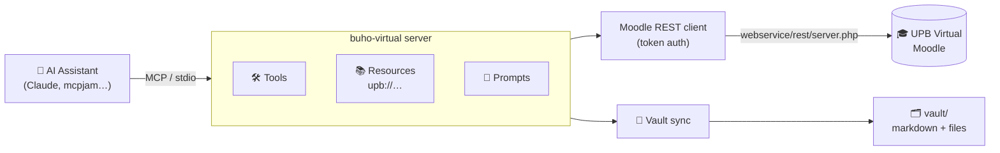
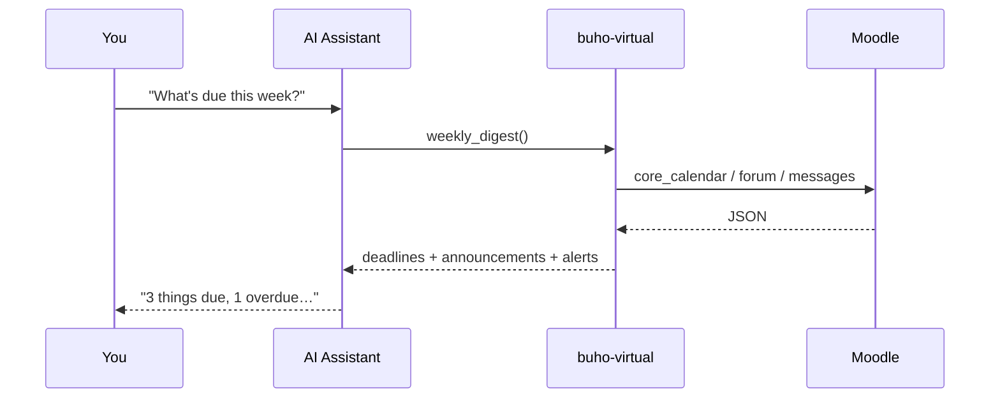

<p align="center">
  
</p>

<p align="center">
  <a href="https://modelcontextprotocol.io"></a>
  
  = 18">
  
  <a href="./LICENSE"></a>
</p>

<p align="center">
  An <a href="https://modelcontextprotocol.io">MCP</a> server for <b>UPB Virtual</b> (Moodle) —
  turn your university LMS into a structured knowledge source an AI assistant can query, sync and reason over.
</p>

---

> *"What's due this week?"* · *"Summarize the latest announcement"* · *"Build a study plan from this course"* · *"Sync all my Algorithms material to markdown"*

It talks to Moodle's official **Web Services REST API** (no browser scraping), so it's fast and
robust. Although it's tuned for UPB Virtual, it works against any Moodle site with web services
enabled — just change `MOODLE_BASE_URL`.

> ⚠️ **Personal tool.** It acts on *your* account with *your* token. Respect your institution's
> terms of service and only access data you're entitled to.

## How it works



A typical request flows straight through to the LMS and back as clean JSON:



## Features

### Tools

| Tool | Description |
|------|-------------|
| `whoami` | Verify the connection; return the authenticated user + site info |
| `list_courses` | All enrolled courses |
| `search_courses` | Search the site catalogue |
| `get_course` | Sections, activities and downloadable files of a course |
| `list_assignments` | Assignments (deadlines + attachments) for one or more courses |
| `get_assignment` | Full detail of one assignment |
| `submission_status` | Whether an assignment is submitted, plus grade/feedback |
| `get_grades` | Grade items and your grades for a course |
| `list_announcements` | Latest announcements for a course |
| `latest_announcements` | Latest announcements across all courses |
| `notifications` | Recent Moodle notifications |
| `upcoming_deadlines` | Calendar deadlines across all courses, sorted |
| `weekly_digest` | One overview: deadlines + announcements + unread notifications |
| `download_file` | Download a Moodle file by its `fileurl` to `./downloads` |
| `pdf_to_markdown` | Convert a local PDF to markdown (text layer) |
| `save_markdown` | Save markdown into the vault |
| `sync_course` | Download all new files of a course into the vault, converting PDFs (incremental) |
| `sync_all` | Sync every enrolled course |

### Resources

Browsable `upb://` URIs a client can attach as context:

- `upb://courses` — enrolled courses
- `upb://course/{id}` — a course's contents
- `upb://course/{id}/assignments` — a course's assignments

### Prompts

Ready-made commands: `weekly_summary`, `study_plan` (arg: `course`), `assignment_checklist` (arg: `assignment`).

## Setup

This package lives in the [buho](../README.md) monorepo. From the repo root:

```bash
npm install
cp .env.example .env        # Windows: copy .env.example .env — then fill in ID and PASSWORD
npm run build
```

With `ID`/`PASSWORD` set, the server exchanges them for a Moodle token at startup
(`login/token.php`) and keeps it in memory. `.env` is gitignored. The `.env` in this folder,
if present, overrides the shared `buho/.env`.

> If the login is rejected, your account may use SSO/Google login, which can disable
> password-based tokens. Generate a token in Moodle under *Preferences → Security keys* and set
> `MOODLE_TOKEN` instead (`npm run get-token` does the same exchange interactively).

### Environment variables

| Variable | Default | Purpose |
|----------|---------|---------|
| `MOODLE_BASE_URL` | `https://www.upbvirtual.net/upbvirtual` | Moodle site root (no trailing slash) |
| `ID` / `PASSWORD` | — | UPB credentials, exchanged for a token when `MOODLE_TOKEN` is unset |
| `MOODLE_TOKEN` | — | Web-services token; takes precedence over `ID`/`PASSWORD` |
| `DOWNLOAD_DIR` | `./downloads` | Where `download_file` saves |
| `VAULT_DIR` | `./vault` | Where synced material is written |
| `CACHE_DIR` | `./.cache` | Incremental-sync metadata |

## Testing with mcpjam

[mcpjam](https://www.mcpjam.com/) spawns the server as a stdio process and gives you a UI to run
tools, browse resources and chat against an LLM.

1. Launch the inspector (opens `http://127.0.0.1:6274`):

   ```bash
   npm run inspect          # = npx @mcpjam/inspector@latest
   ```

2. **Add Server → STDIO**:

   | Field | Value |
   |-------|-------|
   | Transport | `STDIO` |
   | Command | `npx` |
   | Arguments | `tsx src/server.ts` |
   | Working directory | `buhoVirtual/` |

   For the compiled build: `npm run build`, then Command `node`, Arguments `dist/server.js`.

3. Open **Tools** and start with `whoami`. Then `list_courses` → copy an `id` → `get_course`,
   `list_assignments`, `get_grades`, etc.

## Use with Claude / other MCP clients

After `npm run build`, add to your client's MCP config:

```json
{
  "mcpServers": {
    "upb": {
      "command": "node",
      "args": ["/path/to/buho/buhoVirtual/dist/server.js"]
    }
  }
}
```

## Run it (stdio)

To just start the server locally over stdio (the default transport):

```bash
npm run dev        # tsx src/server.ts   — or: npm run build && npm start
```

It waits silently for an MCP client on stdin; that's expected. `Ctrl+C` to stop.

## Run it over HTTP + Cloudflare

The same tools/resources/prompts are also served over **Streamable HTTP**, so a client
can connect from anywhere instead of spawning a local process.

1. Start the HTTP server (listens on `http://localhost:8787/mcp`):

   ```bash
   npm run dev:http               # or: npm run build && npm run start:http
   ```

   Port is configurable: `PORT=8799 npm run dev:http`.

2. Expose it publicly with a Cloudflare **quick tunnel** (no account, no DNS). Install
   [`cloudflared`](https://developers.cloudflare.com/cloudflare-one/connections/connect-networks/downloads/)
   once, then in a second terminal:

   ```bash
   npm run tunnel                 # = cloudflared tunnel --url http://localhost:8787
   ```

   <details>
   <summary>Install <code>cloudflared</code></summary>

   ```bash
   winget install Cloudflare.cloudflared    # Windows
   brew install cloudflared                  # macOS
   ```
   </details>

   cloudflared prints a public URL like `https://random-words.trycloudflare.com`.
   Your MCP endpoint is that URL **+ `/mcp`**.

3. Point any HTTP-capable MCP client at it:

   ```json
   {
     "mcpServers": {
       "upb": {
         "type": "http",
         "url": "https://random-words.trycloudflare.com/mcp"
       }
     }
   }
   ```

   Or with the Claude Code CLI:

   ```bash
   claude mcp add --transport http upb https://random-words.trycloudflare.com/mcp
   ```

> 🔒 **A quick tunnel is a public URL.** The token lives server-side in `.env`, but anyone
> with the URL can call your tools. To gate it, set `MCP_HTTP_TOKEN=<secret>` in `.env` and
> have clients send `Authorization: Bearer <secret>`. For a stable hostname + access policies,
> use a [named tunnel](https://developers.cloudflare.com/cloudflare-one/connections/connect-networks/)
> instead of the quick tunnel.

### HTTP env vars

| Variable | Default | Purpose |
|----------|---------|---------|
| `PORT` | `8787` | Port the HTTP server binds to |
| `MCP_HTTP_TOKEN` | — | If set, requires `Authorization: Bearer <token>` on every request |

## Scripts


| Script | What it does |
|--------|--------------|
| `npm run dev` | Run the server with tsx (**stdio**) |
| `npm run dev:http` | Run the server with tsx (**HTTP**, port `8787`) |
| `npm run build` | Compile to `dist/` |
| `npm start` | Run the compiled server (stdio) |
| `npm run start:http` | Run the compiled server (HTTP) |
| `npm run tunnel` | Expose the HTTP server publicly via Cloudflare |
| `npm run get-token` | Exchange credentials for a token |
| `npm run inspect` | Launch mcpjam inspector |

## Notes & limitations

- `pdf_to_markdown` / `sync_course` extract the PDF **text layer** only (good for slides and notes;
  no tables/math reconstruction). For high-fidelity conversion, plug in a
  [Docling](https://github.com/DS4SD/docling) / PyMuPDF4LLM helper — the rest of the pipeline is
  unchanged.
- Available data depends on what your Moodle role/capabilities expose via web services; some tools
  may return errors if a function is disabled site-wide.

## Project structure

```
src/
  server.ts          MCP server entry (stdio)
  http.ts            MCP server entry (Streamable HTTP)
  http-app.ts        Streamable HTTP app, shared with buhoSistemas/buhoHelp
  index.ts           library entry used by buhoHelp
  config.ts          env config
  tools.ts           tool registrations
  resources.ts       upb:// resources
  prompts.ts         prompt templates
  moodle/
    client.ts        REST transport (token, params, file urls)
    api.ts           typed Moodle function wrappers
  storage/
    cache.ts         incremental-sync cache
  vault/
    sync.ts          sync_course / sync_all
    pdf.ts           pdf -> markdown
    markdown.ts      vault writer
scripts/
  get-token.ts       credentials -> token helper
```

## License

[MIT](./LICENSE)
